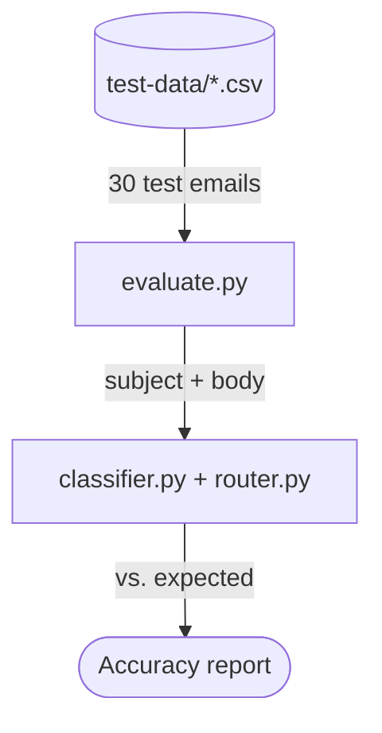

# Architecture – Heido AI Inquiry Triage (Python version)

## 1. Overview

Heido is a fictional IT services company. This system turns customer support emails into tasks automatically:

1. A customer emails the support inbox (heido.support@gmail.com).
2. **Google Gemini** reads the email and returns a title, a one-sentence summary, a category and a priority.
3. A **fixed rule** (not the AI) picks the responsible employee from the category.
4. A task (item) is created on the **monday.com** board "Customer Support", and attachments are uploaded to it.
5. The customer receives a confirmation email with the ticket number (the monday item ID).

This is a code rebuild of the no-code version built on Make.com ([heido-ai-triage](https://github.com/AlisiyaR/heido-ai-triage)).
Both versions automate the same business process; the Make scenario is the reference for intended behavior.
The full requirements are in [build-brief.md](build-brief.md). The reasons behind each design choice are in [adr/](adr/).

## 2. Data flow

### 2.1 Main pipeline (run by `main.py`)


Not shown, to keep the diagram simple:
- `monday_client.py` also gets the title, summary and priority from the classifier, and the sender, date, body and attachments from `email_reader.py`.
- The email is marked as read once its monday item exists ([ADR 0009](adr/0009-mark-as-read-after-item-created.md)).

### 2.2 Evaluation (offline accuracy test)



`evaluate.py` uses the same classifier and router as the pipeline, but no Gmail and no monday.

## 3. Components

| File | Responsibility | Status |
|---|---|---|
| `config.py` | All settings in one place: secrets from `.env`, plus fixed constants (categories, routing table, monday column IDs, confirmation email, limits) | Built |
| `gmail_client.py` | Signs in to the Gmail API with OAuth and returns a ready-to-use Gmail service | Built |
| `prompt.txt` | The AI prompt (v3), with `{subject}` and `{body}` placeholders | Built |
| `classifier.py` | Calls Gemini, validates the answer, retries temporary errors, respects the rate limit | Built |
| `router.py` | Category → employee, a fixed rule | Built |
| `evaluate.py` | Measures accuracy on the 30 test emails, without Gmail or monday | Built |
| `email_reader.py` | Reads up to 15 unread INBOX emails (subject, body, sender, date, attachments) and marks them as read | Built |
| `monday_client.py` | Creates the monday item with all 10 columns and uploads attachments | Built |
| `mailer.py` | Sends the confirmation email through the Gmail API | Built |
| `main.py` | Runs the full pipeline, with logging, `--dry-run`, `--once` and a repeat interval | Built |

## 4. Component details

### 4.1 Settings: `config.py`
- **Secrets** (`GEMINI_API_KEY`, `MONDAY_API_TOKEN`, `MONDAY_BOARD_ID`, `MONDAY_GROUP_ID`) are loaded from `.env` with `python-dotenv`. They are never written in the code.
- `require_env(name)` stops the program at start-up with a clear message (e.g. `Missing MONDAY_GROUP_ID in .env`) if a value is missing. Failing early with a clear message is better than failing later with a confusing one.
- **Fixed constants** are copied from the Make scenario: the 9 `CATEGORIES`, `ROUTING`, `COLUMNS` (monday column IDs), the confirmation email, `MAX_EMAILS_PER_RUN = 15` and `GEMINI_REQUESTS_PER_MINUTE = 15`.
- Other files use `import config`, so a changed column ID or employee name is fixed in one place. See [ADR 0008](adr/0008-secrets-in-env-and-central-config.md).

### 4.2 Gmail connection: `gmail_client.py`
- Uses the **Gmail API with OAuth** (Desktop app flow), not IMAP with a password. See [ADR 0001](adr/0001-gmail-api-with-oauth.md).
- Two files:

  | File | What it is | Where it comes from |
  |---|---|---|
  | `credentials.json` | Identifies the **app** ("who is asking for access") | Downloaded once from Google Cloud Console |
  | `token.json` | The **user's** saved login ("who allowed it") | Created automatically after the first browser sign-in |

- Scope: `gmail.modify`, which allows reading emails, marking them as read and sending the confirmation. It does **not** allow permanent deletion. We ask only for what we need.
- `get_gmail_service()`:
  1. If `token.json` exists, load the saved login from it.
  2. If there is no valid login: refresh it quietly if it only expired; otherwise open the browser to sign in.
  3. Save the login to `token.json` for next time.
  4. Return a `service` object used to talk to Gmail.
- `get_own_address(service)` returns the signed-in inbox's address. `main.py` uses it for the loop guard, and the `mailer.py` self-test uses it to refuse the support address.
- While the Google Cloud app is in **Testing** mode, `token.json` expires after 7 days. Delete it and run again to sign in.

### 4.3 AI classification: `prompt.txt` + `classifier.py`
- **Input:** only the email subject and body. The sender's address is never sent (data minimization). See [ADR 0007](adr/0007-send-only-subject-and-body-to-ai.md).
- **Prompt:** stored in `prompt.txt`, so it can be improved without changing code. See [ADR 0006](adr/0006-prompt-in-separate-file.md). It is **v3**: the brief's v2 plus "in English" for the title ([ADR 0016](adr/0016-prompt-v3-english-title.md)).
- **Model:** `gemini-3.5-flash-lite`, thinking level LOW (as in Make).
- **Response schema:** the Pydantic model `Classification` (`title`, `summary`, `category`, `priority`) is passed to Gemini, so it must return JSON in exactly that shape. The SDK turns it into a `Classification` object.
- **Functions:**
  - `classify(subject, body)` – the only function other files use: build the prompt, call Gemini, validate.
  - `call_gemini(prompt)` – the API call, with rate limiting and retries.
  - `validate(result)` – an unknown category becomes `Other / Unclassified`; an unknown priority becomes `Medium`. Each fix is logged as a warning. See [ADR 0003](adr/0003-structured-output-and-validation.md).
  - `wait_for_rate_limit()` and `get_retry_delay(error)` – see section 7.
- **Language:** whatever language the customer writes in, the monday task is in English. Category, priority, status and assignee are fixed English lists; the summary and the title are English by the prompt. The **Original Message**, the customer's name and file names stay exactly as the customer wrote them. Tested with Hebrew and Swedish emails.

### 4.4 Routing: `router.py`
- `assign(category)` looks the category up in `config.ROUTING`. This is a **fixed rule, not the AI**, like the Switch module in Make. See [ADR 0002](adr/0002-fixed-routing-not-ai.md).

  | Employee | Categories |
  |---|---|
  | Daniel Anderson | Login & Access Issues, Software & System Issues, Performance Issues |
  | Ryan Mitchell | Network & Connectivity Issues, Hardware Issues, Installation & Configuration |
  | Emily Carter (default) | Everything else, including unexpected values |

### 4.5 Evaluation: `evaluate.py`
- Runs the classifier and router on the 30 test emails in `test-data/` (the same files as the Make version) and compares each answer to the expected one.
- `python evaluate.py` runs both files; `--out results.csv` also saves all rows (git-ignored).
- Prints a report per file and a **Combined** report: accuracy for category, priority and assignee, errors, and mismatches.
- **Errors are kept apart from wrong answers.** A mismatch means the AI answered differently than expected; an error (e.g. a 429) means there was no answer at all. Accuracy counts only answered emails. See [ADR 0010](adr/0010-evaluation-excludes-errors.md).

### 4.6 Reading emails: `email_reader.py`
- Uses the Gmail service from `gmail_client.py`. The service is passed in as a parameter, so `main.py` creates it once and reuses it for reading and sending.
- Two small data classes hold the result:
  - `Email`: `message_id`, `subject`, `body`, `from_name`, `from_email`, `received_at` (UTC), `attachments`
  - `Attachment`: `filename`, `mime_type`, `data` (the file's bytes)
- `fetch_unread(service)` asks Gmail for up to 15 messages with both the `INBOX` and `UNREAD` labels. Gmail returns the newest first, so the list is reversed and the oldest are handled first. Reading an email does **not** mark it as read.
- Each email is fetched in Gmail's **raw** format: the whole email, files included, in one download. Python's built-in `email` package parses it, so the code does not decode MIME parts, charsets or base64 by hand ([ADR 0015](adr/0015-raw-format-and-python-email-package.md)).
- `parse_message()` builds an `Email` from it:
  - **Sender:** `"Dana Cohen <dana@x.com>"` is split into name and address.
  - **Time:** Gmail's `internalDate` (milliseconds since 1970) becomes a UTC date and time.
  - **Subject and sender name:** decoded automatically, including Hebrew.
  - **Body:** `get_body()` picks the plain-text part, or the HTML part (tags removed) if the email is HTML only. `get_content()` decodes it with the charset the email declares (e.g. Hebrew `windows-1255`).
  - **Attachments:** every file in the email, **including images pasted into the body** (like Make's "has attachment or media"). An image without a name gets one, e.g. `inline_1.png`. `walk()` goes through every part of the email to find them.
- `mark_as_read(service, message_id)` removes the `UNREAD` label. `main.py` calls it once the monday item exists ([ADR 0009](adr/0009-mark-as-read-after-item-created.md)).
- The rules for picking the body, the attachments and the order are in [ADR 0011](adr/0011-email-parsing-rules.md).

### 4.7 Creating the monday task: `monday_client.py`
- Talks to the monday.com **GraphQL API** with `requests`: one HTTPS request with a short "query" saying what to do; monday answers with JSON. The token from `.env` goes in the `Authorization` header.
- `build_column_values(email, classification, assignee)` prepares the 9 column values (it does not call monday, so it can be tested offline):

  | Column | ID | Value |
  |---|---|---|
  | Category | `color_mm91tmat` | the AI's category, as a status label (created if missing) |
  | Priority | `priority` | `High` / `Medium` / `Low` label |
  | Status | `project_status` | `Not Started` label |
  | Assigned to | `dropdown_mm91ncnc` | the employee from `router.py` (one label) |
  | Original Message | `long_text_mm91q00k` | the email body |
  | Customer Email | `email_mm91b42r` | the sender's address |
  | Received At | `date_mm91b4bh` | date and time, UTC |
  | Summary | `text_mm94sk4j` | the AI's one-sentence summary |
  | Customer Name | `text_mm94v9bp` | the sender's name, or the address if there is no name |

- `create_item(email, classification, assignee)` creates the item in the board and group from `.env`, named with the AI's title, and returns the **item ID**, which is the ticket number. Values are sent as GraphQL **variables**, never pasted into the query text, so quotes in an email cannot break the request.
- `upload_file(item_id, attachment)` uploads one file to the **Files** column (`file`) through monday's file endpoint. It is called once per attachment.
- `check_response()` turns any monday error (HTTP error, `errors` list or `error_message`) into a `RuntimeError` with monday's own message. There are no retries for monday calls.
- Status and dropdown values are set by **label text**, not by Make's label numbers. See [ADR 0012](adr/0012-monday-labels-by-text.md).

### 4.8 Sending the confirmation: `mailer.py`
- `send_confirmation(service, to_address, item_id, title)` sends the confirmation from the brief through the Gmail API, using the same connection as `email_reader.py`. It returns the sent Gmail message ID.
- **Subject:** "We received your request – Ticket {item_id}". **Body:** the HTML from the brief, with the ticket number and topic filled in (templates in `config.py`).
- **The title is HTML-escaped.** It is AI text based on the customer's email, so something like `<script>` must show as text, not run.
- A **plain-text version** is included for email apps that do not show HTML. It is made from the HTML with `email_reader.strip_html()`, so the template exists only once.
- Sent as a **new email** (not a reply), like Make. Gmail fills in the "From" address (the support inbox).
- Errors are passed up to `main.py`, which logs them without retrying (the monday item already exists, [ADR 0009](adr/0009-mark-as-read-after-item-created.md)).
- **Email-loop guard:** a confirmation sent to the support inbox itself would come back as a new unread email and become a ticket. The self-test refuses that address, and `main.py` will skip emails sent by the inbox itself. See [ADR 0013](adr/0013-confirmation-email-format.md).

### 4.9 Running the pipeline: `main.py`
- **How to run:**
  - `python main.py`: checks the inbox every 5 minutes until Ctrl+C (`--interval N` changes the minutes).
  - `python main.py --once`: one run, then exit.
  - `python main.py --dry-run --once`: a rehearsal. Reads and classifies, logs what *would* be created; writes nothing to monday, sends nothing, marks nothing as read.
- **Start-up:** connects to Gmail **once** and reads the inbox's own address (for the loop guard).
- **For each unread email** (`process_email`), in this order:
  1. Sent by the support inbox itself? Skip it (and mark it as read).
  2. Classify with Gemini (`classifier.classify`), with the rate limit and retries.
  3. Pick the employee (`router.assign`).
  4. Dry run? Log the result and stop here.
  5. Create the monday item (`monday_client.create_item`).
  6. **Mark the email as read right away** (ADR 0009).
  7. Upload each attachment (`upload_attachments`); a failed file is logged and the rest continue.
  8. Send the confirmation (`try_send_confirmation`); a failure is logged.
  9. Log one summary line.
- **What a failure does:**

  | Fails at | Result |
  |---|---|
  | Steps 2–5 (Gemini, monday item) | `ERROR ... failed (left unread)`. The email stays unread and is retried next run. Other emails continue. |
  | Step 7 (one file) | Logged; other files and the confirmation continue. The ticket exists without that file. |
  | Step 8 (confirmation) | Logged as `confirmation=failed`. The ticket exists; the customer gets no email. |
  | Whole run (e.g. no internet) | Logged; the loop tries again at the next interval. |

- **Logs:** every line goes to the console and to `logs/heido.log` (git-ignored, next to `main.py`). One line per email, for example:

  ```
  2026-11-22 14:03:12 INFO msg=18c4... category='Hardware Issues' priority=High assignee='Ryan Mitchell' item=2084731552 files=1/1 confirmation=sent
  ```

  Each run ends with `Run finished: N email(s), X created, Y skipped, Z dry run, W failed`. Customer email text is not written to the log.
  The Google and HTTP libraries (`googleapiclient`, `google_genai`, `httpx2`) are set to WARNING, so their routine INFO lines (one per request) are hidden; their warnings and errors still appear.
- **Ready for a scheduler:** with `--once`, the exit code is `0` if no email failed and `1` otherwise (an email that was left unread, or a failed run). File paths (`credentials.json`, `token.json`, `prompt.txt`, `.env`, `logs/`) are found next to the code, so the program works when started from any folder. See [ADR 0014](adr/0014-polling-loop-and-per-email-isolation.md).

## 5. External services

| Service | Used for | Access | Credentials |
|---|---|---|---|
| Gmail API | Read unread emails, mark as read, send confirmations | `google-api-python-client` | `credentials.json` + `token.json` (OAuth) |
| Google Gemini | Classify each email | `google-genai` SDK | `GEMINI_API_KEY` in `.env` |
| monday.com | Create items and upload files | GraphQL API over HTTPS (`requests`) | `MONDAY_API_TOKEN` in `.env` |

## 6. Configuration and secrets

| Where | What | In git? |
|---|---|---|
| `.env` | `GEMINI_API_KEY`, `MONDAY_API_TOKEN`, `MONDAY_BOARD_ID`, `MONDAY_GROUP_ID` | No (git-ignored) |
| `.env.example` | The same keys with empty values, as a template | Yes |
| `credentials.json` | Google OAuth client (identifies the app) | No (git-ignored) |
| `token.json` | Saved Gmail login | No (git-ignored) |
| `config.py` | Everything that is not secret | Yes |

## 7. Error handling and limits

- **Gemini rate limit (15 requests per minute, free tier).** `wait_for_rate_limit()` runs before every Gemini call, retries included, and keeps calls at least 4 seconds apart (60 / 15). Both `evaluate.py` and the pipeline call Gemini only through `classify()`, so both are protected. A full run of 15 emails takes at least about 60 seconds, so one run fits into the per-minute limit. The limit works inside one running program only. See [ADR 0005](adr/0005-client-side-gemini-rate-limit.md).
- **Retries.** Only temporary errors are retried: 429 (rate limit) and 503 (overloaded), up to 5 attempts. The wait is Google's `retryDelay` + 1 second when given, otherwise 5s, 10s, 20s, 40s (`BACKOFF_SECONDS`). If Google asks for more than 60 seconds (usually the daily quota), the call fails instead of waiting. Any other error (e.g. a wrong API key) fails immediately. See [ADR 0004](adr/0004-retry-only-temporary-errors.md).
- **Emails per run.** At most 15 (`MAX_EMAILS_PER_RUN`; Make used 11), oldest of those first, so one run fits into Gemini's 15-per-minute limit. With more than 15 unread, the 15 newest are taken and the rest wait for the next run ([ADR 0011](adr/0011-email-parsing-rules.md)).
- **Per email (`main.py`):**
  - Each email is processed on its own, so one failing email does not stop the others.
  - An email is marked as read once its monday item exists. If classification or item creation fails, it stays unread and is retried next run. A failed upload or confirmation is logged but not retried, to avoid duplicate tickets. See [ADR 0009](adr/0009-mark-as-read-after-item-created.md).
  - Emails sent by the support inbox itself are skipped and marked as read (loop guard, [ADR 0013](adr/0013-confirmation-email-format.md)).
- **Whole run:** if a run fails (e.g. no internet), the loop logs it and tries again at the next interval. With `--once`, the exit code is `1`.

## 8. Evaluation results

Prompt v3, `gemini-3.5-flash-lite`, run on 2026-11-23 (4 emails hit Gemini overload errors in the full run and were rerun individually):

| Set | Category | Priority | Assignee |
|---|---|---|---|
| Development (T01–T15) | 100% | 100% | 100% |
| Holdout (H01–H15) | 100% | 93% | 100% |
| **Combined (30)** | **100%** | **97%** | **100%** |

The only miss is H10's priority, the known borderline case. Prompt v2 (and the Make version) scored 93/100/93, 100/93/100 and 97/97/97 combined; see [ADR 0016](adr/0016-prompt-v3-english-title.md). One email is about 7% of a 15-email set, and the AI is not fully repeatable, so a run can differ by one email.

## 9. Repository layout

```
heido-ai-triage-code/
├── config.py            # settings and constants
├── gmail_client.py      # Gmail API + OAuth
├── prompt.txt           # AI prompt (v3)
├── classifier.py        # Gemini call, validation, retry, rate limit
├── router.py            # category → employee
├── evaluate.py          # accuracy test
├── email_reader.py      # read unread emails and attachments
├── monday_client.py     # create the monday item, upload files
├── mailer.py            # send the confirmation email
├── main.py              # runs the full pipeline
├── test-data/           # 30 test emails (from the Make version)
├── docs/
│   ├── ARCHITECTURE.md  # this file
│   ├── adr/             # one file per design decision
│   ├── python-concepts.md
│   ├── final-check.md   # checked against the definition of done
│   └── build-brief.md   # original requirements
├── requirements.txt
├── .env.example
├── LICENSE
└── CLAUDE.md
```

Python concepts used in the code are explained in [python-concepts.md](python-concepts.md).
