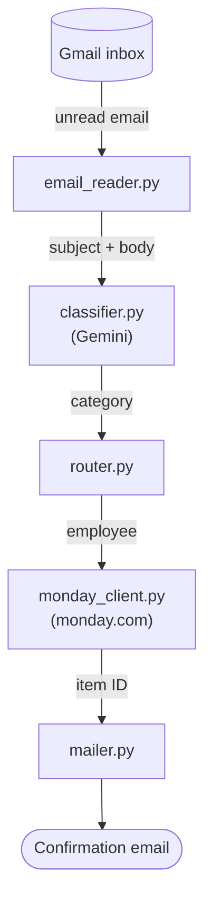

# Architecture – Heido AI Inquiry Triage (Python version)

## 1. Overview

Heido is a fictional IT services company. This system turns customer support emails into tasks automatically:

1. A customer emails the support inbox (heido.support@gmail.com).
2. **Google Gemini** reads the email and returns a title, a one-sentence summary, a category and a priority.
3. A **fixed rule** (not the AI) picks the responsible employee from the category.
4. A task (item) is created on the **monday.com** board "Customer Support", and attachments are uploaded to it.
5. The customer receives a confirmation email with the ticket number (the monday item ID).

This is a code rebuild of the no-code version built on Make.com ([heido-ai-triage](https://github.com/AlisiyaR/heido-ai-triage)).
Both versions automate the same business process; the Make scenario is the reference for intended behavior.
The full requirements are in [build-brief.md](build-brief.md). The reasons behind each design choice are in [adr/](adr/).

## 2. Data flow

### 2.1 Main pipeline (run by `main.py`, planned)



Not shown, to keep the diagram simple:
- `monday_client.py` also gets the title, summary and priority from the classifier, and the sender, date, body and attachments from `email_reader.py`.
- The email is marked as read once its monday item exists ([ADR 0009](adr/0009-mark-as-read-after-item-created.md)).

### 2.2 Evaluation (offline accuracy test)


`evaluate.py` uses the same classifier and router as the pipeline, but no Gmail and no monday.

## 3. Components

| File | Responsibility | Status |
|---|---|---|
| `config.py` | All settings in one place: secrets from `.env`, plus fixed constants (categories, routing table, monday column IDs, confirmation email, limits) | Built |
| `gmail_client.py` | Signs in to the Gmail API with OAuth and returns a ready-to-use Gmail service | Built |
| `prompt.txt` | The AI prompt (v2), with `{subject}` and `{body}` placeholders | Built |
| `classifier.py` | Calls Gemini, validates the answer, retries temporary errors, respects the rate limit | Built |
| `router.py` | Category → employee, a fixed rule | Built |
| `evaluate.py` | Measures accuracy on the 30 test emails, without Gmail or monday | Built |
| `email_reader.py` | Reads up to 20 unread INBOX emails (subject, body, sender, date, attachments) and marks them as read | Built |
| `monday_client.py` | Creates the monday item with all 10 columns and uploads attachments | Planned |
| `mailer.py` | Sends the confirmation email through the Gmail API | Planned |
| `main.py` | Runs the full pipeline, with logging, `--dry-run`, `--once` and a repeat interval | Planned |

## 4. Component details

### 4.1 Settings: `config.py`
- **Secrets** (`GEMINI_API_KEY`, `MONDAY_API_TOKEN`, `MONDAY_BOARD_ID`, `MONDAY_GROUP_ID`) are loaded from `.env` with `python-dotenv`. They are never written in the code.
- `require_env(name)` stops the program at start-up with a clear message (e.g. `Missing MONDAY_GROUP_ID in .env`) if a value is missing. Failing early with a clear message is better than failing later with a confusing one.
- **Fixed constants** are copied from the Make scenario: the 9 `CATEGORIES`, `ROUTING`, `COLUMNS` (monday column IDs), the confirmation email, `MAX_EMAILS_PER_RUN = 20` and `GEMINI_REQUESTS_PER_MINUTE = 15`.
- Other files use `import config`, so a changed column ID or employee name is fixed in one place. See [ADR 0008](adr/0008-secrets-in-env-and-central-config.md).

### 4.2 Gmail connection: `gmail_client.py`
- Uses the **Gmail API with OAuth** (Desktop app flow), not IMAP with a password. See [ADR 0001](adr/0001-gmail-api-with-oauth.md).
- Two files:

  | File | What it is | Where it comes from |
  |---|---|---|
  | `credentials.json` | Identifies the **app** ("who is asking for access") | Downloaded once from Google Cloud Console |
  | `token.json` | The **user's** saved login ("who allowed it") | Created automatically after the first browser sign-in |

- Scope: `gmail.modify`, which allows reading emails, marking them as read and sending the confirmation. It does **not** allow permanent deletion. We ask only for what we need.
- `get_gmail_service()`:
  1. If `token.json` exists, load the saved login from it.
  2. If there is no valid login: refresh it quietly if it only expired; otherwise open the browser to sign in.
  3. Save the login to `token.json` for next time.
  4. Return a `service` object used to talk to Gmail.
- While the Google Cloud app is in **Testing** mode, `token.json` expires after 7 days. Delete it and run again to sign in.

### 4.3 AI classification: `prompt.txt` + `classifier.py`
- **Input:** only the email subject and body. The sender's address is never sent (data minimization). See [ADR 0007](adr/0007-send-only-subject-and-body-to-ai.md).
- **Prompt:** stored in `prompt.txt`, so it can be improved without changing code. See [ADR 0006](adr/0006-prompt-in-separate-file.md).
- **Model:** `gemini-3.5-flash-lite`, thinking level LOW (as in Make).
- **Response schema:** the Pydantic model `Classification` (`title`, `summary`, `category`, `priority`) is passed to Gemini, so it must return JSON in exactly that shape. The SDK turns it into a `Classification` object.
- **Functions:**
  - `classify(subject, body)` – the only function other files use: build the prompt, call Gemini, validate.
  - `call_gemini(prompt)` – the API call, with rate limiting and retries.
  - `validate(result)` – an unknown category becomes `Other / Unclassified`; an unknown priority becomes `Medium`. Each fix is logged as a warning. See [ADR 0003](adr/0003-structured-output-and-validation.md).
  - `wait_for_rate_limit()` and `get_retry_delay(error)` – see section 7.

### 4.4 Routing: `router.py`
- `assign(category)` looks the category up in `config.ROUTING`. This is a **fixed rule, not the AI**, like the Switch module in Make. See [ADR 0002](adr/0002-fixed-routing-not-ai.md).

  | Employee | Categories |
  |---|---|
  | Daniel Anderson | Login & Access Issues, Software & System Issues, Performance Issues |
  | Ryan Mitchell | Network & Connectivity Issues, Hardware Issues, Installation & Configuration |
  | Emily Carter (default) | Everything else, including unexpected values |

### 4.5 Evaluation: `evaluate.py`
- Runs the classifier and router on the 30 test emails in `test-data/` (the same files as the Make version) and compares each answer to the expected one.
- `python evaluate.py` runs both files; `--out results.csv` also saves all rows (git-ignored).
- Prints a report per file and a **Combined** report: accuracy for category, priority and assignee, errors, and mismatches.
- **Errors are kept apart from wrong answers.** A mismatch means the AI answered differently than expected; an error (e.g. a 429) means there was no answer at all. Accuracy counts only answered emails. See [ADR 0010](adr/0010-evaluation-excludes-errors.md).

### 4.6 Reading emails: `email_reader.py`
- Uses the Gmail service from `gmail_client.py`. The service is passed in as a parameter, so `main.py` creates it once and reuses it for reading and sending.
- Two small data classes hold the result:
  - `Email`: `message_id`, `subject`, `body`, `from_name`, `from_email`, `received_at` (UTC), `attachments`
  - `Attachment`: `filename`, `mime_type`, `data` (the file's bytes)
- `fetch_unread(service)` asks Gmail for up to 20 messages with both the `INBOX` and `UNREAD` labels. Gmail returns the newest first, so the list is reversed and the oldest are handled first. Reading an email does **not** mark it as read.
- `parse_message()` builds an `Email` from Gmail's raw data:
  - **Sender:** `"Dana Cohen <dana@x.com>"` is split into name and address.
  - **Time:** Gmail's `internalDate` (milliseconds since 1970) becomes a UTC date and time.
  - **Body:** the first plain-text part; if the email is HTML only, the HTML with tags removed. The text is decoded with the charset the email declares (e.g. Hebrew `windows-1255`).
  - **Attachments:** every file in the email, **including images pasted into the body** (like Make's "has attachment or media"). An image without a name gets one, e.g. `inline_1.png`. Small files come inside the message; larger ones are downloaded separately.
- `mark_as_read(service, message_id)` removes the `UNREAD` label. `main.py` calls it once the monday item exists ([ADR 0009](adr/0009-mark-as-read-after-item-created.md)).
- The rules for picking the body, the attachments and the order are in [ADR 0011](adr/0011-email-parsing-rules.md).

## 5. External services

| Service | Used for | Access | Credentials |
|---|---|---|---|
| Gmail API | Read unread emails, mark as read, send confirmations | `google-api-python-client` | `credentials.json` + `token.json` (OAuth) |
| Google Gemini | Classify each email | `google-genai` SDK | `GEMINI_API_KEY` in `.env` |
| monday.com | Create items and upload files | GraphQL API over HTTPS (`requests`) | `MONDAY_API_TOKEN` in `.env` |

## 6. Configuration and secrets

| Where | What | In git? |
|---|---|---|
| `.env` | `GEMINI_API_KEY`, `MONDAY_API_TOKEN`, `MONDAY_BOARD_ID`, `MONDAY_GROUP_ID` | No (git-ignored) |
| `.env.example` | The same keys with empty values, as a template | Yes |
| `credentials.json` | Google OAuth client (identifies the app) | No (git-ignored) |
| `token.json` | Saved Gmail login | No (git-ignored) |
| `config.py` | Everything that is not secret | Yes |

## 7. Error handling and limits

- **Gemini rate limit (15 requests per minute, free tier).** `wait_for_rate_limit()` runs before every Gemini call, retries included, and keeps calls at least 4 seconds apart (60 / 15). Both `evaluate.py` and the pipeline call Gemini only through `classify()`, so both are protected. 20 emails take at least about 80 seconds. The limit works inside one running program only. See [ADR 0005](adr/0005-client-side-gemini-rate-limit.md).
- **Retries.** Only temporary errors are retried: 429 (rate limit) and 503 (overloaded), up to 3 attempts. The wait is Google's `retryDelay` + 1 second when given, otherwise 2s then 4s. If Google asks for more than 60 seconds (usually the daily quota), the call fails instead of waiting. Any other error (e.g. a wrong API key) fails immediately. See [ADR 0004](adr/0004-retry-only-temporary-errors.md).
- **Emails per run.** At most 20 (`MAX_EMAILS_PER_RUN`; Make used 11), oldest of those first. With more than 20 unread, the 20 newest are taken and the rest wait for the next run ([ADR 0011](adr/0011-email-parsing-rules.md)).
- **Planned in `main.py`:**
  - Each email is processed on its own, so one failing email does not stop the others.
  - An email is marked as read once its monday item exists. If classification or item creation fails, it stays unread and is retried next run. A failed upload or confirmation is logged but not retried, to avoid duplicate tickets. See [ADR 0009](adr/0009-mark-as-read-after-item-created.md).

## 8. Evaluation results

Prompt v2, `gemini-3.5-flash-lite`, run on 2026-11-22:

| Set | Category | Priority | Assignee | Errors |
|---|---|---|---|---|
| Development (T01–T15) | 93% | 100% | 93% | 0 |
| Holdout (H01–H15) | 100% | 93% | 100% | 0 |
| **Combined (30)** | **97%** | **97%** | **97%** | **0** |

These match the Make version exactly. One email is about 7% of a 15-email set, and the AI is not fully repeatable, so a run can differ by one email.

## 9. Repository layout

```
heido-ai-triage-code/
├── config.py            # settings and constants
├── gmail_client.py      # Gmail API + OAuth
├── prompt.txt           # AI prompt (v2)
├── classifier.py        # Gemini call, validation, retry, rate limit
├── router.py            # category → employee
├── evaluate.py          # accuracy test
├── email_reader.py      # read unread emails and attachments
├── test-data/           # 30 test emails (from the Make version)
├── docs/
│   ├── ARCHITECTURE.md  # this file
│   ├── adr/             # one file per design decision
│   ├── python-concepts.md
│   └── build-brief.md   # original requirements
├── requirements.txt
├── .env.example
├── LICENSE
└── CLAUDE.md
```

Python concepts used in the code are explained in [python-concepts.md](python-concepts.md).
